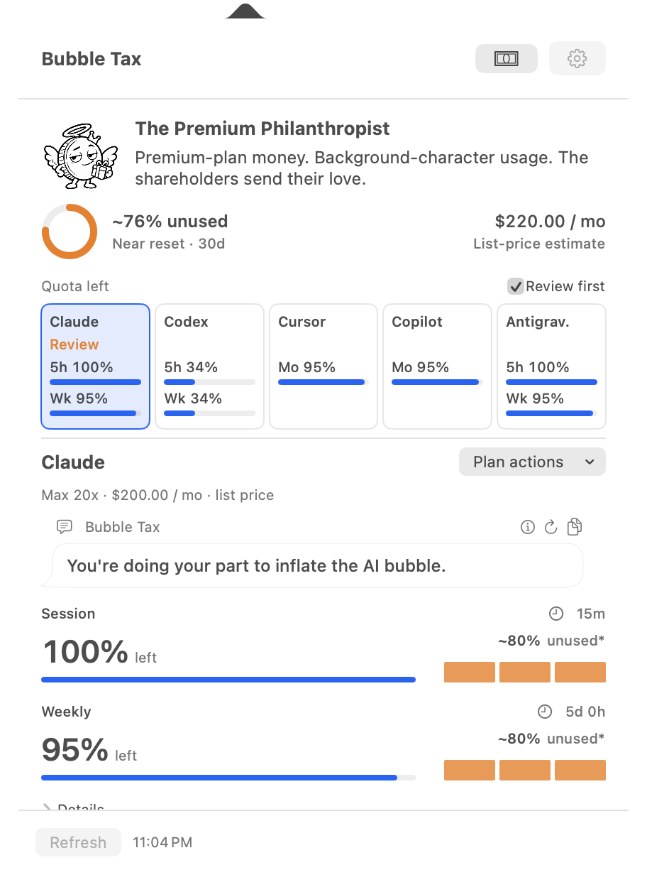
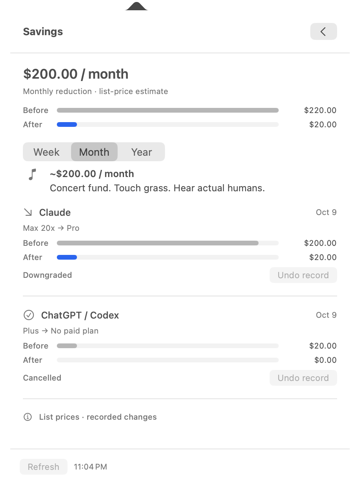
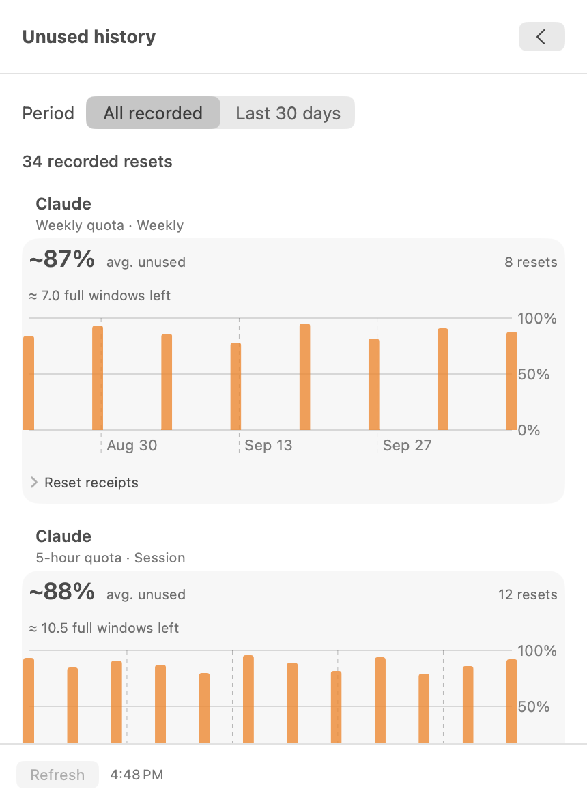

# Bubble Tax

**Stop sponsoring the AI bubble.**

A Mac menu-bar app for AI subscriptions you pay for and barely use.
See what is **left**, spot the plans worth reviewing, and keep a record when you cancel or downgrade.

[Download the Mac app](https://github.com/bubble-tax/bubble-tax-bar/releases/download/v0.1.0-build.10/Bubble-Tax-0.1.0-macOS-arm64.zip) · [Website](https://bubble-tax.github.io/) · [Release notes](https://github.com/bubble-tax/bubble-tax-bar/releases/tag/v0.1.0-build.10)


## Your quota is chilling. Your subscription money isn't.

One compact menu for **Claude, ChatGPT / Codex, Cursor, GitHub Copilot and Antigravity**.
On a MacBook with a notch, click the quota beside the camera to expand the app. Other displays use the menu bar. Paid-plan quotas rotate every eight seconds while collapsed. Open it to see each service's remaining limits, weekly-quota persona and a roast that follows the evidence.

<table>
  <tr>
    <td align="center"><strong>What you still haven't used</strong></td>
    <td align="center"><strong>What you stopped paying for</strong></td>
  </tr>
  <tr>
    <td valign="top">
<a href="site/assets/overview.png">
<picture>
  <source media="(prefers-color-scheme: dark)" srcset="site/assets/overview-dark.png">
  <source media="(prefers-color-scheme: light)" srcset="site/assets/overview.png">
  
</picture>
</a>
    </td>
    <td valign="top">
<a href="site/assets/savings.png">
<picture>
  <source media="(prefers-color-scheme: dark)" srcset="site/assets/savings-dark.png">
  <source media="(prefers-color-scheme: light)" srcset="site/assets/savings.png">
  
</picture>
</a>
    </td>
  </tr>
</table>

Actual macOS captures with illustrative sample data. Images follow your GitHub light or dark theme; click to view at full size.

## Left today. Unused when the window expires.

A quiet afternoon isn't a reason to cancel a plan. Bubble Tax keeps weekly and session limits separate, and records balances observed near reset so you can see repeated unused headroom over time.

<p align="center">
<a href="site/assets/unused-history.png">
<picture>
  <source media="(prefers-color-scheme: dark)" srcset="site/assets/unused-history-dark.png">
  <source media="(prefers-color-scheme: light)" srcset="site/assets/unused-history.png">
  
</picture>
</a>
</p>

Claude window receipts show how the 5-hour and weekly meters move together, with separate handling for resets, gaps and plan changes. [See the comparison screen](docs/images/claude-window-history.png) (sample data).

Compare smaller plans, review the provider's cancellation options, then record the change **after you complete it**. Savings shows estimated monthly list-price reductions. Work plans use seat reviews and stay outside personal savings.

The point is to spend less, not burn more tokens to justify the bill.

## Try the preview

**v0.1.0 · Build 10 · Apple silicon · macOS 14+**

1. [Download the ZIP](https://github.com/bubble-tax/bubble-tax-bar/releases/download/v0.1.0-build.10/Bubble-Tax-0.1.0-macOS-arm64.zip), extract it and move **Bubble Tax.app** to Applications.
2. Open the app, then click **†** in the menu bar. There is no Dock window.
3. Open Settings to connect existing provider sessions or choose local log folders, then refresh.

Provider quotas, local log activity and the Claude statusline bridge work without installing Python or developer tools. Both collectors ship inside the app. Move it to Applications before connecting the Claude bridge; reconnect if you move it later.

This preview is **Developer ID signed; Apple notarization is not complete**. If macOS blocks first launch, follow [Apple's instructions for opening an app from an unknown developer](https://support.apple.com/guide/mac-help/open-a-mac-app-from-an-unknown-developer-mh40616/mac). Installation details and checksums are on the [release page](https://github.com/bubble-tax/bubble-tax-bar/releases/tag/v0.1.0-build.10). No Intel build is included.

## What the numbers mean

- Quotas come from available provider sessions. Local Claude / Codex logs and Pi coding-agent sessions add activity; token counts alone cannot establish subscription quota or who paid.
- ChatGPT's displayed quota is **Codex quota**, not every ChatGPT feature. Availability depends on the provider and authentication; missing readings stay unknown.
- Claude and Codex window history shows local model activity alongside quota changes. The main screen estimates the daily pattern needed to finish the weekly quota.
- History and completed-change records stay on your Mac. USD list prices are estimates, not your invoices, refunds or accumulated cash saved.
- Bubble Tax opens provider instructions. It does not cancel subscriptions or change billing on your behalf.

## Build it locally

Requires Swift 5.9+, python.org Python 3.12 (for bundling the collector) and an Apple silicon Mac running macOS 14 or later.

```bash
bash scripts/run.command
```

The script runs the tests, builds the app and opens `dist/Bubble Tax.app`.
PyInstaller and its build dependencies are installed into a project-local virtual environment. To select a Python 3.12 executable, set `BUBBLE_TAX_BUILD_PYTHON=/path/to/python3.12`.

```bash
bash scripts/package-release.sh 0.1.0
```

This produces the signed preview ZIP and `SHA256SUMS.txt` in `dist/releases/0.1.0/`.
The app is ad-hoc signed; building locally does not notarize it.
The read-only provider helper is bundled; it is not installed globally.

[Usage & data guide](docs/APP_GUIDE.md) · [Signing & notarization](docs/SIGNING.md) · [Price sources](docs/PRICE_CATALOG.md) · [Landing-page source](site/) · [v0.1.0 notes](docs/releases/v0.1.0.md)

Includes the MIT-licensed [CodexBarCLI](vendor/codexbar/PROVENANCE.md) by Peter Steinberger. Its [license](vendor/codexbar/LICENSE) ships with the app. The packaged local collector also includes Python and the PyInstaller bootloader; their license notices are included in `Contents/Resources/Collector-LICENSES.txt`.

---

Coffee money? In this AI economy? [If you insist.](https://buymeacoffee.com/workromancer)
